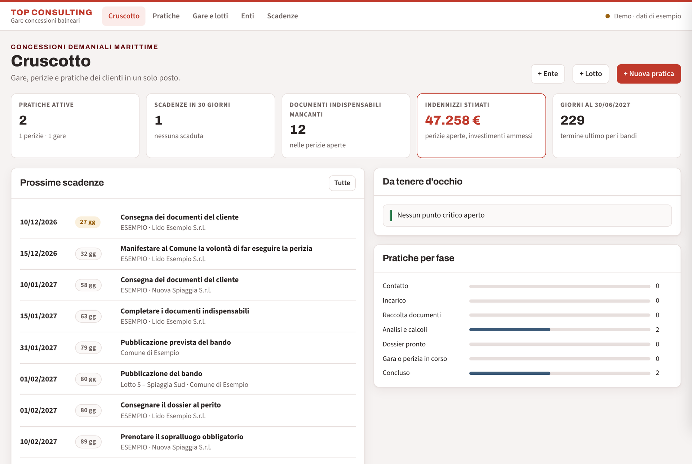
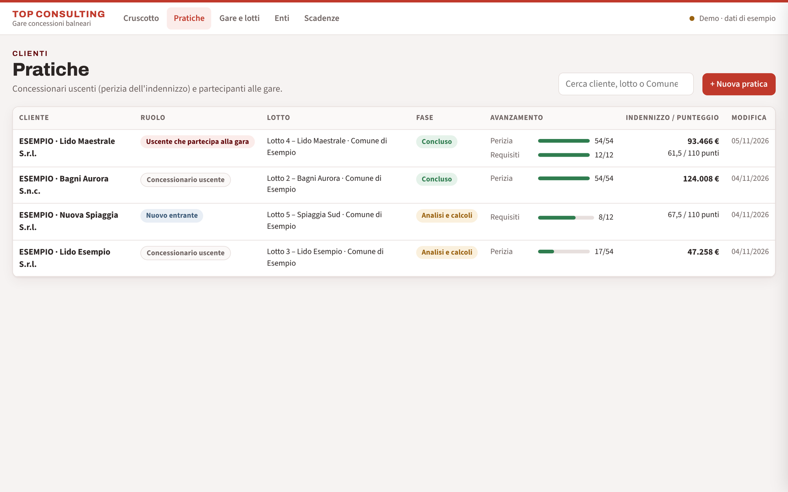
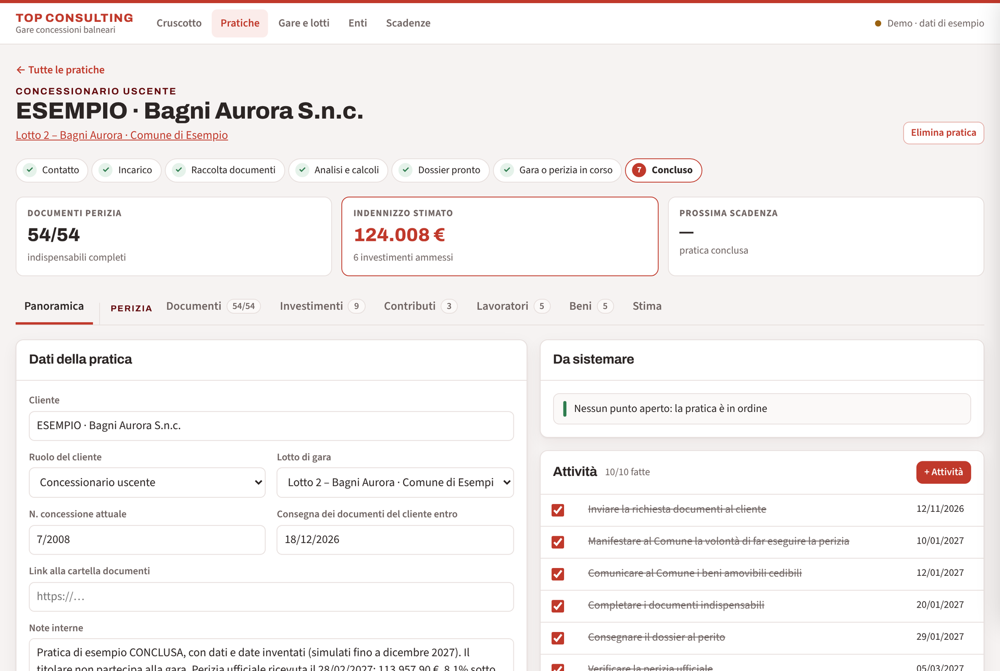
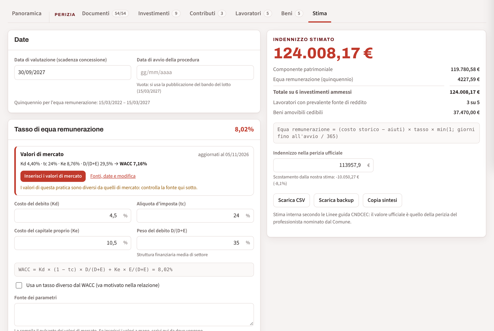
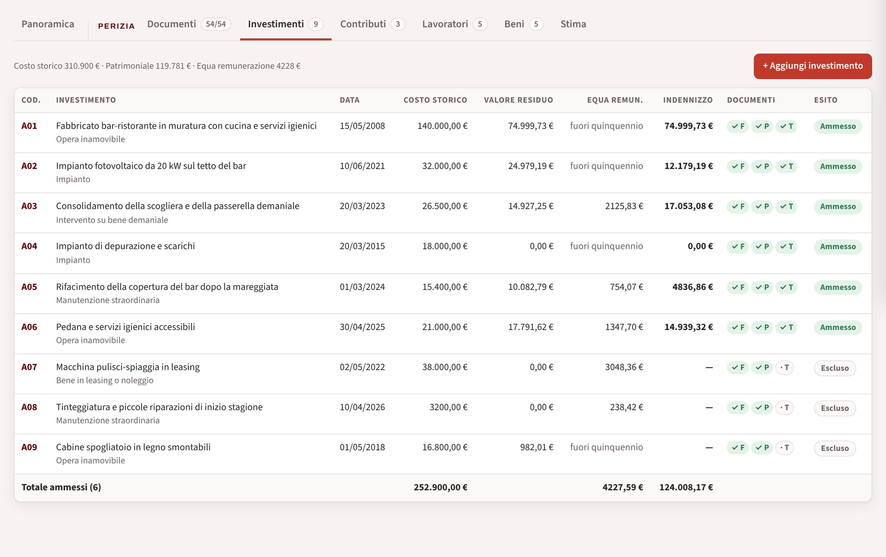
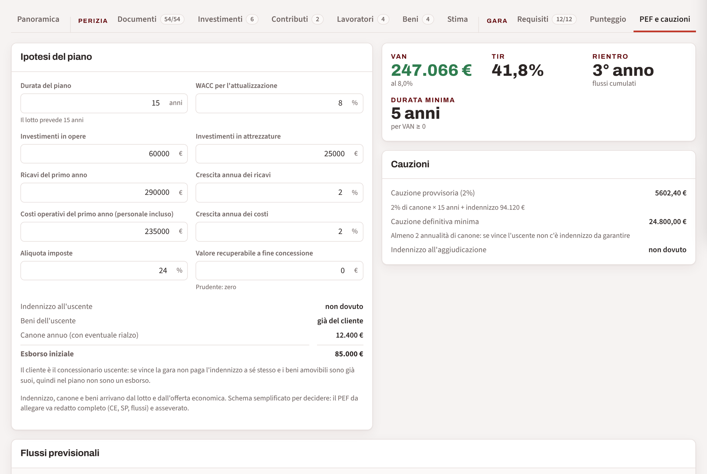
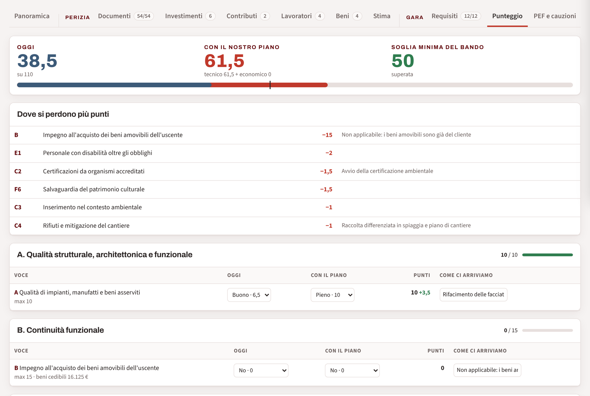
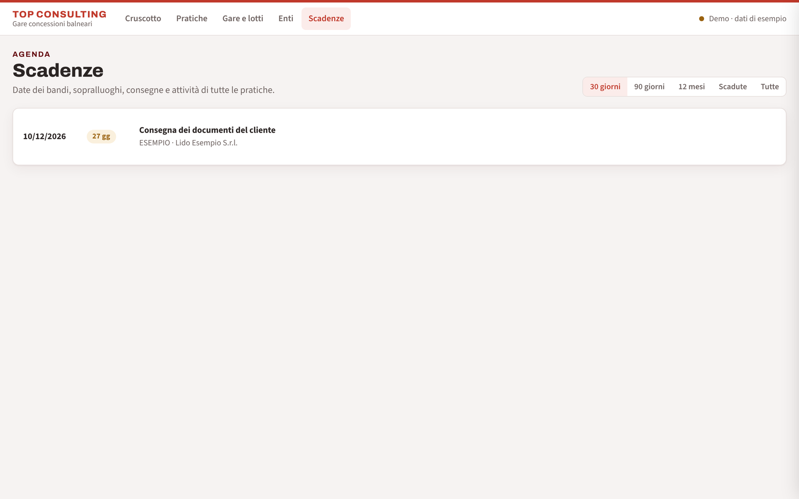
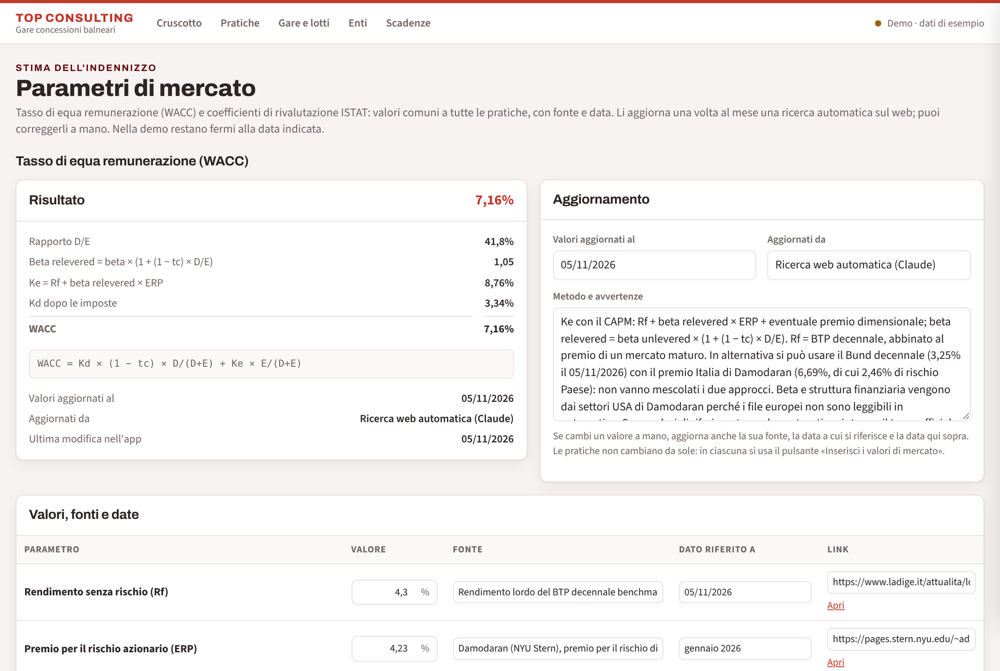

# Gestionale gare balneari

Web app ideata e sviluppata da **Eldoraldo Halaj** per **Top Consulting S.r.l.**, per seguire le gare delle concessioni demaniali marittime turistico-ricreative (L. 118/2022, bando tipo e Linee guida CNDCEC). Copre le perizie di indennizzo per i concessionari uscenti, le offerte e i PEF per chi partecipa alla gara e le scadenze di tutte le pratiche.

**Demo su richiesta:** scrivi a eldoraldoh@gmail.com o chiama il +39 389 245 7414.

## Cosa fa

**Cruscotto e scadenze**
- Pratiche attive, documenti mancanti, indennizzi stimati e giorni al termine ultimo per i bandi (30/06/2027).
- Agenda unica con le date di bandi, sopralluoghi, consegne e attività di tutte le pratiche.

**Pratiche per ruolo del cliente**
- Concessionario uscente, nuovo partecipante, oppure uscente che partecipa comunque alla gara.
- Avanzamento per fasi: contatto, incarico, raccolta documenti, analisi e calcoli, dossier pronto, gara o perizia in corso, concluso.

**Perizia di indennizzo (concessionario uscente)**
- Checklist dei documenti da chiedere al cliente, con testo di sollecito pronto da copiare.
- Registro di investimenti, contributi pubblici, lavoratori e beni amovibili cedibili.
- Stima secondo le Linee guida CNDCEC:
  - componente patrimoniale più equa remunerazione sugli investimenti degli ultimi cinque anni;
  - rivalutazione ISTAT;
  - deperimento e obsolescenza;
  - limite del valore d'uso;
  - deduzione integrale degli aiuti pubblici.
- Confronto tra la stima interna e la perizia ufficiale.

**Gara (partecipante)**
- Verifica dei requisiti di partecipazione.
- Simulazione del punteggio sui criteri del bando tipo (A–G più offerta economica).
- PEF semplificato con VAN, TIR, anno di rientro e durata minima della concessione.
- Calcolo della cauzione provvisoria e di quella definitiva.

**Parametri di mercato**
- Tasso di equa remunerazione (WACC con CAPM) e coefficienti di rivalutazione ISTAT, ciascuno con fonte, link e data di riferimento.
- Li aggiorna ogni mese una ricerca automatica; restano sempre correggibili a mano.

**Lavoro di squadra ed export**
- Archivio condiviso tra i colleghi, con permessi di lettura e modifica.
- Stima in CSV, backup della pratica in JSON e sintesi da copiare.

## Schermate

| | |
|---|---|
|  |  |
| Elenco pratiche | Panoramica di una pratica |
|  |  |
| Stima dell'indennizzo | Registro degli investimenti |
|  |  |
| PEF e cauzioni | Simulazione del punteggio |
|  |  |
| Scadenze | Parametri di mercato |

## Avvertenze

- Le stime prodotte dall'app sono un supporto interno. Il valore ufficiale dell'indennizzo è quello della perizia asseverata del professionista nominato dall'ente concedente.
- Le pratiche nelle schermate sono di fantasia.

---

Ideato e sviluppato da Eldoraldo Halaj per Top Consulting S.r.l.

© 2026 Eldoraldo Halaj — Tutti i diritti riservati.
